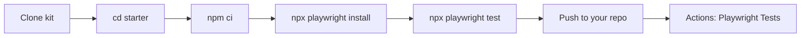

# AI-Native Test Automation — Starter Kit

Environment setup kit for the **AI-Native Test Automation Engineering**
course. It gets every student to a green Lab 0: a working Playwright +
TypeScript project running locally and in GitHub Actions.

## Quick start

1. Complete the [Environment Checklist](docs/environment-checklist.md).
2. Run the read-only validator:

   ``` bash
   bash scripts/verify-environment.sh
   ```

   Windows (PowerShell):

   ``` powershell
   powershell -ExecutionPolicy Bypass -File scripts\verify-environment.ps1
   ```

3. Follow the [Lab 0 Guide](docs/lab-0-guide.md).

## Recovery path

If your own Lab 0 project breaks and the
[Troubleshooting](docs/troubleshooting.md) Quick Fix doesn't solve it
in about 5 minutes, use the ready-made project in
[`starter/`](starter/README.md):

``` bash
cd starter
npm ci
npx playwright install
npx playwright test
```

Then push the kit to your own GitHub repository — the
**Playwright Tests** workflow runs there automatically.



## Repository structure

``` text
AI-Native-Test-Automation-Starter/
├── README.md
├── LICENSE                              # MIT
├── .gitignore
├── .github/workflows/
│   ├── validate-kit.yml                 # runs the env validators
│   └── playwright.yml                   # runs the starter/ tests
├── docs/
│   ├── environment-checklist.md
│   ├── windows-setup.md
│   ├── macos-setup.md
│   ├── troubleshooting.md
│   ├── lab-0-guide.md
│   ├── ci-quality-gates.md              # CI gates, artifacts, required check
│   ├── test-strategy.md                 # Capstone: requirements, risks, scope
│   ├── architecture.md                  # Capstone: layers and dependencies
│   ├── traceability.md                  # Capstone: BR → tests → evidence
│   ├── risk-register.md                 # Capstone: risks and mitigations
│   ├── adr/                             # Capstone: architecture decisions
│   ├── capstone-review.md               # Capstone: final engineering review
│   └── capstone-defense.md              # Capstone: defense guide
├── scripts/
│   ├── verify-environment.sh            # read-only validator (macOS/Linux)
│   └── verify-environment.ps1           # read-only validator (Windows)
└── starter/                             # the course project (see starter/README.md)
    ├── pages/                           # SauceDemo Page Objects
    ├── api/                             # DummyJSON ProductsApi
    ├── tests/                           # UI (SauceDemo) + API (DummyJSON) tests
    ├── observability/                   # results normalization, metrics, report
    └── playwright.config.ts
```

## Scope

This repository started as the Lab 0 setup kit and now carries the
course project built through Increments #01–#09:

- **Environment:** setup guides, read-only validators, troubleshooting.
- **`starter/`:** the evolved project, with SauceDemo UI tests on Page
  Objects, DummyJSON API tests, CI quality gates, and an observability
  module. See [`starter/README.md`](starter/README.md) and
  [`docs/architecture.md`](docs/architecture.md).
- The project still needs Node.js, npm, Git, and network access to the
  public practice sites (SauceDemo, DummyJSON).

## License

[MIT](LICENSE)
