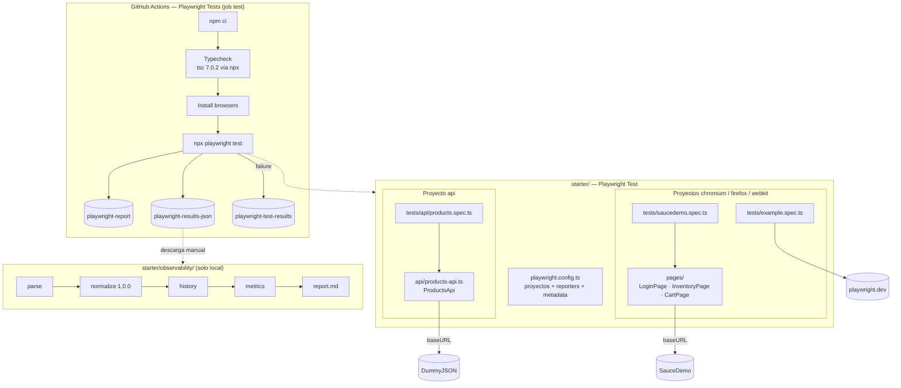

# Arquitectura

## Vista general



## Responsabilidades

| Componente | Es responsable de | No es responsable de |
| --- | --- | --- |
| Tests (`tests/`) | La intención del escenario y **todas las aserciones** | Selectores o rutas de endpoints |
| Page Objects (`pages/`) | Conocer la UI: selectores y acciones | Aserciones; datos de prueba |
| `ProductsApi` (`api/`) | Conocer el endpoint: la ruta `/products/{id}` | Aserciones; validar la respuesta |
| `playwright.config.ts` | Entornos (`baseURL` por proyecto), reporters, reintentos, metadatos de CI | La lógica de las pruebas |
| Workflow `playwright.yml` | Ejecutar los gates y conservar la evidencia | Bloquear el merge (eso lo hace un ruleset, pendiente) |
| `observability/` | Convertir resultados reales en métricas trazables | Cambiar el resultado de CI |

## Dependencias

```text
saucedemo.spec.ts ──▶ pages/* ──▶ Page (Playwright) ──▶ SauceDemo
products.spec.ts  ──▶ api/products-api.ts ──▶ APIRequestContext ──▶ DummyJSON
observability/cli.ts ──▶ parse ──▶ normalize ──▶ history ──▶ metrics ──▶ report
```

- Las dependencias van en una sola dirección y no hay ciclos.
- La UI y la API no se conocen entre sí.
- La observabilidad solo lee archivos de resultados; no importa nada de
  `tests/`, `pages/` ni `api/`.

## Decisiones

| ADR | Decisión |
| --- | --- |
| [0001](adr/0001-page-objects-without-base-page.md) | Page Objects sin BasePage; las aserciones viven en los tests |
| [0002](adr/0002-thin-products-api.md) | `ProductsApi` delgado sobre `APIRequestContext`, sin cliente HTTP genérico |
| [0003](adr/0003-single-ci-job-quality-gates.md) | Un solo job de CI con typecheck y todos los proyectos |
| [0004](adr/0004-local-static-observability.md) | Observabilidad local y estática (JSON y Markdown), sin base de datos |
| [0005](adr/0005-keep-example-tests.md) | Mantener por ahora las pruebas de ejemplo de Playwright |
