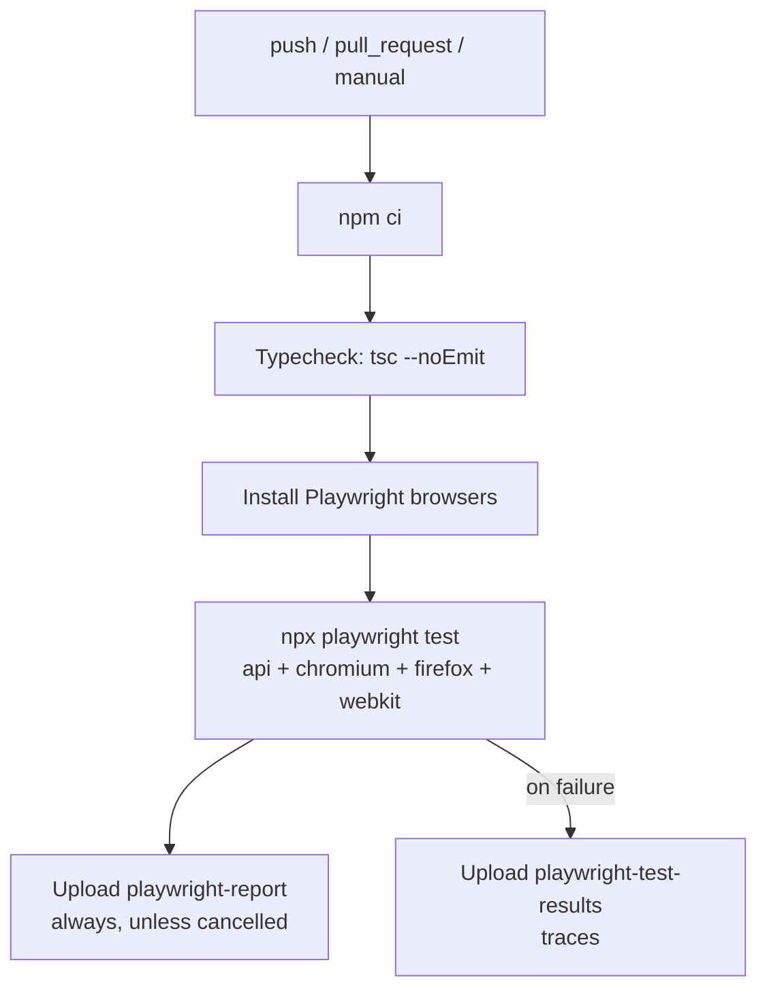

# CI Quality Gates

How the **Playwright Tests** workflow
([`.github/workflows/playwright.yml`](../.github/workflows/playwright.yml))
validates the `starter/` project, how to reproduce it locally, and how
to turn it into a merge rule.

## What the `test` check validates



| Gate | Command (in `starter/`) | Passes when |
| --- | --- | --- |
| Install | `npm ci` | The lockfile installs cleanly |
| Typecheck | `npx --yes -p typescript@7.0.2 tsc --noEmit` | Zero TypeScript errors |
| API + UI tests | `npx playwright test` | Every test passes; at least one test is found |

Any failed gate fails the job, so the `test` check turns red. Nothing
in the workflow converts a failure into success: there is no
`continue-on-error` or `|| true`. The upload steps never change the
job result.

The test step runs **all** Playwright projects:

| Project | System under test | Base URL |
| --- | --- | --- |
| `api` | DummyJSON Products (HTTP only, no browser) | `https://dummyjson.com` |
| `chromium`, `firefox`, `webkit` | SauceDemo UI | `https://www.saucedemo.com` |

These are separate systems. API tests never set up SauceDemo state.

## Run the gates locally

```bash
cd starter
npm ci
npx --yes -p typescript@7.0.2 tsc --noEmit
npx playwright install
npx playwright test                 # everything, as CI does
npx playwright test --project=api   # API only
```

> `tsconfig.json` includes `**/*.ts`, so the local typecheck also
> checks your git-ignored `scratch/` practice files. CI never sees them.

## Evidence (artifacts)

| Artifact | When | Retention | Contents |
| --- | --- | --- | --- |
| `playwright-report` | Every run that is not cancelled | 30 days | HTML report. Open it with `npx playwright show-report <folder>` |
| `playwright-test-results` | Only when the job fails | 14 days | Traces of retried tests. Open one with `npx playwright show-trace <trace.zip>` |

Artifacts contain no secrets. The only credentials in traces are the
**public** SauceDemo demo account shown on its login page.

## Make `test` a required check (manual, admin only)

The workflow **reports** a status. It blocks merges only after a
repository admin configures a rule. This increment does not change
any GitHub setting.

1. Open **Settings → Rules → Rulesets**, or **Settings → Branches →
   Branch protection rules**.
2. Target the `main` branch.
3. Enable **Require status checks to pass**.
4. Add the check named **`test`** (from *Playwright Tests*). It
   appears in the list after the workflow has run at least once.
5. Optional: also require **Require a pull request before merging**.

Until an admin verifies these settings, treat the check as
informational.

## Known trade-offs

- **Duplicate runs:** `push` runs on all branches, so a PR branch runs
  twice per commit (push + pull_request). `concurrency` only cancels
  older runs of the *same* PR.
- **Retries hide flakiness:** `retries: 2` on CI means a test that
  passes on retry keeps the check green. It is marked *flaky* in the
  report, so review the report and do not rely on the check color
  alone.
- **External services:** SauceDemo and DummyJSON are public
  third-party sites. An outage fails the check without any code
  change.
- **Floating Node version:** `node-version: lts/*` follows the current
  LTS release.
- **Typecheck download:** TypeScript is fetched by `npx` on each run.
  The version is pinned, but the package is not protected by the
  lockfile integrity hash.
