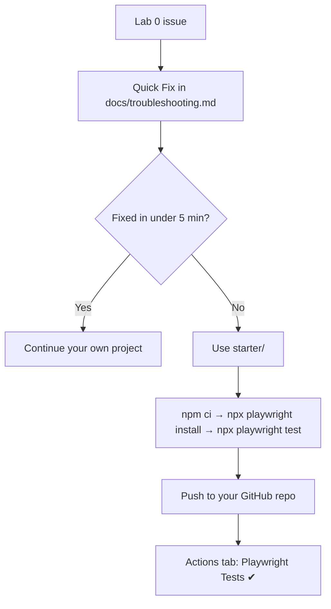

# Starter — Lab 0 Recovery Project

A ready-to-run Playwright + TypeScript project. Use it when your own
Lab 0 setup is broken and you want to keep going with the course.

> **This is a recovery tool, not the course framework.** It is the
> plain output of the Playwright initializer — no Page Objects,
> fixtures, or abstractions. You will build those properly during the
> course.

## When to use it

``` text
Lab 0 issue → Quick Fix (docs/troubleshooting.md) → Fixed in <5 min?
 ├── Yes → continue your own project
 └── No  → this starter project → continue the course
```



Try the [Troubleshooting](../docs/troubleshooting.md) Quick Fix first.

## Requirements — read this first

Clone-and-continue skips the scaffold, **not** the environment. You
still need:

- [ ] Node.js LTS (v20 or newer) and npm
- [ ] Git
- [ ] Network access to `registry.npmjs.org` (for `npm ci`) and
      `cdn.playwright.dev` (for the browser download)

If your blocker is a **restricted network** (proxy, firewall, blocked
downloads), this project fails the same way your own did. The fix is a
different network or an IT request — see
[Restricted network](../docs/troubleshooting.md#restricted-network).

## Run it (under 5 minutes)

From the root of the cloned kit:

``` bash
cd starter
npm ci
npx playwright install
npx playwright test
```

Expected result:

``` text
Running 6 tests using N workers
  ✓  1 [chromium] › tests/example.spec.ts:3:5 › has title
  ...
  6 passed
```

6 tests = 2 example tests × 3 browsers (Chromium, Firefox, WebKit).
On Linux, use `npx playwright install --with-deps` if the browsers
need system libraries.

Useful commands:

| Command | npm script |
| --- | --- |
| `npx playwright test` | `npm test` |
| `npx playwright test --ui` | `npm run test:ui` |
| `npx playwright show-report` | `npm run report` |

## Publish to your own GitHub repository

The CI workflow lives at the kit root
(`.github/workflows/playwright.yml`) and runs the tests inside
`starter/`. Push the **whole kit**, not only the `starter/` folder.

1. On GitHub, create an **empty** repository (no README, no license).
2. From the kit root, point `origin` at your repository and push:

``` bash
cd ..
git remote set-url origin https://github.com/<your-user>/<your-repo>.git
git push -u origin main
```

3. Open the **Actions** tab of **your** repository. The
   **Playwright Tests** workflow runs and should finish green. Its
   HTML report is attached to the run as the `playwright-report`
   artifact.

## What's inside

``` text
starter/
├── package.json           # pinned @playwright/test + @types/node
├── package-lock.json      # committed — makes npm ci reproducible
├── tsconfig.json          # editor support, moduleResolution "Bundler"
├── playwright.config.ts   # generated config, list + html reporters
├── .gitignore             # test output and node_modules
└── tests/
    └── example.spec.ts    # generated example tests
```

`node_modules/` and browsers are never committed — `npm ci` and
`npx playwright install` restore them.
