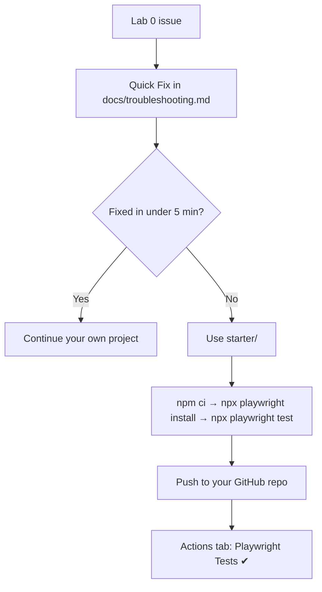

# Starter — Course Project

A Playwright + TypeScript project. It began as the Lab 0 recovery
project and now holds the course work from Increments #01–#09:

- **UI (SauceDemo):** login, login rejection, catalog, and cart flows on
  Page Objects (`pages/`).
- **API (DummyJSON):** product by id and the not-found contract, through
  `api/products-api.ts`.
- **CI quality gates:** typecheck plus every Playwright project (see
  [`docs/ci-quality-gates.md`](../docs/ci-quality-gates.md)).
- **Observability:** JSON results normalized into metrics and a report
  (see [`observability/README.md`](observability/README.md)).

Architecture and decisions: [`docs/architecture.md`](../docs/architecture.md).

## When to use it

``` text
Lab 0 issue → Quick Fix (docs/troubleshooting.md) → Fixed in <5 min?
 ├── Yes → continue your own project
 └── No  → this starter project → continue the course
```



Try the [Troubleshooting](../docs/troubleshooting.md) Quick Fix first.

## Requirements — read this first

Clone-and-continue skips the scaffold, **not** the environment. You
still need:

- [ ] Node.js LTS (v20 or newer) and npm
- [ ] Git
- [ ] Network access to `registry.npmjs.org` (for `npm ci`) and
      `cdn.playwright.dev` (for the browser download)

If your blocker is a **restricted network** (proxy, firewall, blocked
downloads), this project fails the same way your own did. The fix is a
different network or an IT request — see
[Restricted network](../docs/troubleshooting.md#restricted-network).

## Run it (under 5 minutes)

From the root of the cloned kit:

``` bash
cd starter
npm ci
npx playwright install
npx playwright test
```

Expected result:

``` text
Running 17 tests using N workers
  ...
  17 passed
```

17 tests break down as follows:

- 2 API tests run once, in the `api` project (no browser).
- 5 UI tests run in each of 3 browsers (Chromium, Firefox, WebKit):
  - 3 SauceDemo tests;
  - 2 Playwright example tests.

The public sites must be reachable. On Linux, use
`npx playwright install --with-deps` if the browsers need system
libraries.

Useful commands:

| Command | npm script |
| --- | --- |
| `npx playwright test` | `npm test` |
| `npx playwright test --ui` | `npm run test:ui` |
| `npx playwright show-report` | `npm run report` |
| `npx playwright test --project=api` | — (API tests only) |
| `npx --yes -p typescript@7.0.2 tsc --noEmit` | — (typecheck, as CI runs it) |
| Observability unit tests | `npm run obs:test` |
| Import results / build report | `npm run obs:import -- results/playwright-results.json`, `npm run obs:report` |

## Publish to your own GitHub repository

The CI workflow lives at the kit root
(`.github/workflows/playwright.yml`) and runs the tests inside
`starter/`. Push the **whole kit**, not only the `starter/` folder.

1. On GitHub, create an **empty** repository (no README, no license).
2. From the kit root, point `origin` at your repository and push:

``` bash
cd ..
git remote set-url origin https://github.com/<your-user>/<your-repo>.git
git push -u origin main
```

3. Open the **Actions** tab of **your** repository. The
   **Playwright Tests** workflow runs and should finish green. Its
   HTML report is attached to the run as the `playwright-report`
   artifact.

## What's inside

``` text
starter/
├── package.json           # pinned @playwright/test + @types/node, obs:* scripts
├── package-lock.json      # committed — makes npm ci reproducible
├── tsconfig.json          # strict, noEmit, moduleResolution "Bundler"
├── playwright.config.ts   # projects api/chromium/firefox/webkit; list + html + json reporters
├── .gitignore             # test output, results, observability data
├── pages/                 # SauceDemo Page Objects (login, inventory, cart)
├── api/
│   └── products-api.ts    # DummyJSON /products/{id}
├── tests/
│   ├── saucedemo.spec.ts  # UI: login rejection, inventory + price, cart
│   ├── api/products.spec.ts  # API: product by id, 404 contract
│   └── example.spec.ts    # Playwright example tests (kept, see docs/adr)
└── observability/         # parser, contract 1.0.0, metrics, report, unit tests
```

`node_modules/` and browsers are never committed — `npm ci` and
`npx playwright install` restore them.
