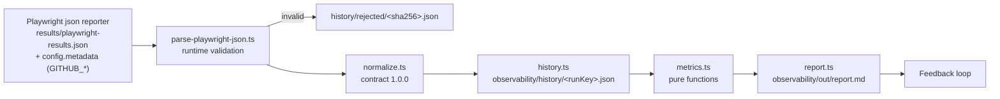

# Test Observability

This module turns real Playwright results into normalized data, reproducible
metrics and a static Markdown report. It has no dependencies beyond Node and
Playwright, needs no database, and never runs inside CI.

> **Observing is not inventing.** If data is missing, the report says
> **Insufficient data**. It never fills gaps with zeros or fabricated trends.

## Data flow



| File | Responsibility |
| --- | --- |
| `contract.ts` | Normalized, versioned contract (`SCHEMA_VERSION`) |
| `parse-playwright-json.ts` | Validates the **real** Playwright JSON format (verified on 1.64.1) |
| `normalize.ts` | Logical outcomes, attempts, completeness, keys, provenance, redaction |
| `metrics.ts` | Pure metric functions (no clock, network or filesystem) |
| `history.ts` | Idempotent local history; conflicts are never overwritten |
| `report.ts` | Static Markdown report (pure, `generatedAt` injected) |
| `cli.ts` | `import` / `report` commands |
| `tests/` | Logic tests with **synthetic** fixtures (`synthetic-report.ts`) |

## Usage (from `starter/`)

```bash
npx playwright test                                   # writes results/playwright-results.json
npm run obs:import -- results/playwright-results.json  # normalize + add to history
npm run obs:report                                     # writes observability/out/report.md
npm run obs:test                                       # unit tests of this module
```

Both `import` and `report` accept `--history <dir>`; `report` also accepts
`--out <file>`. Exit codes: `0` ok, `1` not processable or conflict, `2` usage.

> Passing `--reporter=...` on the command line replaces the configured
> reporters, so **no JSON is written**. Run `npx playwright test` without it
> when you want results for observability.

### Importing CI runs

CI uploads the artifact **`playwright-results-json`** (30 days). Downloading
it requires a GitHub login (the API answers `401` without authentication):

1. Open the run in **Actions**.
2. Download `playwright-results-json` and unzip it outside the repo.
3. Run `npm run obs:import -- <path>/playwright-results.json`.

CI files carry `GITHUB_RUN_ID`, `GITHUB_SHA` and related values, so the
report links each run to its GitHub Actions page.

## Contract (schema 1.0.0)

| Field | Meaning | Provenance / null policy |
| --- | --- | --- |
| `runKey` | `gha:<runId>:<runAttempt>` in CI, `local:<sha256>` otherwise | Dedup key. `runAttempt` → `unknown` if missing |
| `source.rawFile`, `rawSha256` | Raw file path and hash at import time | The path may be overwritten later; the hash proves which content was used |
| `execution.startTime`, `durationMs` | `stats.startTime`, `stats.duration` (runner wall time) | `playwright-json` |
| `execution.ci` | GitHub context from `config.metadata` | `ci-metadata`, or `null` for local runs. `runUrl` only if server + repo + run id exist |
| `config.projects[]` | name, retries, repeatEach | Used for comparability |
| `completeness` | `complete` / `partial` / `unknown` + reasons | See below |
| `tests[].testKey` | `<project>::<file>::<describe > title>` | A rename creates a new identity; collisions get `#n` + warning |
| `tests[].outcome` | Logical result after retries | See mapping |
| `tests[].attempts[]` | retry, status, durationMs, errorCount | **No** error messages, stdout/stderr or attachments |

**Outcome mapping** (Playwright `test.status`):

| Playwright | Outcome |
| --- | --- |
| `expected` | `passed` |
| `unexpected` | `failed` |
| `flaky` (failed, then passed on retry) | `flaky`, **one** logical test |
| `skipped` | `skipped` |
| anything else, or a non-skipped test with **no attempts** | `unknown` (never `passed`) |

`test.fail()` tests that fail as expected are reported by Playwright as
`expected`, so they count as `passed`.

**Completeness:**
- **`partial`:** an attempt was `interrupted`, Playwright reported global
  errors, a test never ran, or a status is unknown.
- **`unknown`:** the report contains no tests.
- **Rejected:** a file is rejected when it is empty, is not valid JSON, or
  breaks the expected structure. Rejections are recorded in
  `history/rejected/`.

**Idempotency:**
- Importing the same file twice → `unchanged`.
- Same `runKey` with a different hash → **conflict**. The existing file is
  never overwritten.

## Metrics dictionary

| Metric | Formula | Denominator / exclusions | Unit | Granularity | Limitations |
| --- | --- | --- | --- | --- | --- |
| Counts | number of passed, failed, flaky, skipped and unknown | Logical tests, not attempts | tests | run, project | — |
| Executed | passed + failed + flaky | excludes skipped, unknown | tests | run | — |
| Pass rate | (passed + flaky) / executed | `null` if executed = 0 | % | run | 100% ≠ no risk |
| First-attempt pass rate | passed / executed | same | % | run | — |
| Flaky rate | flaky / executed | only if some project has retries > 0, else *Not measurable* | % | run | Local runs use retries = 0 |
| Runner duration | `stats.duration` | — | ms | run | Not push-to-feedback time |
| Test duration | sum of attempt durations | — | ms | test | Network-dependent (public sites) |
| p50 / p90 duration | nearest-rank percentile | ≥ 5 comparable complete runs | ms | test | Sample size shown |
| Pass-rate trend | last − first pass rate | ≥ 5 comparable complete runs | pp | history | Change ≠ cause |
| Completeness | complete / partial / unknown / rejected | all imported files | runs | history | — |

**Comparable runs:** same projects, same retries and same repeatEach, and the
run must be `complete`. If more than one configuration exists, the report warns
and uses only the largest group.

## Feedback loop

1. **Signal:** the report shows a change, for example a test that turned flaky
   or failed.
2. **Evidence:** open the raw file or the CI run linked in the report, then the
   HTML report and traces.
3. **Hypothesis:** write down the suspected cause, separating facts from
   guesses.
4. **Proposed action:** the smallest change that addresses it.
5. **Human approval** before changing code.
6. **Later validation:** import new runs and compare comparable data.

## Retention and cleanup

| Data | Location | Git | Retention |
| --- | --- | --- | --- |
| Raw results (local) | `results/` | ignored | Overwritten by every run |
| Raw results (CI) | artifact `playwright-results-json` | — | 30 days |
| History | `observability/history/` | ignored | Until you delete it |
| Report | `observability/out/report.md` | ignored | Regenerated |

To clean up, delete `observability/history/` and `observability/out/`.
History is local and **not durable**. Persisting it across machines would need
a separate decision.

## Limitations

- Only runs you import exist for the report. There is no automatic collection
  from CI.
- Before this increment, CI produced no JSON. Earlier runs **cannot** be
  measured.
- Runs with Node's built-in TypeScript support. The scripts silence Node's
  `MODULE_TYPELESS_PACKAGE_JSON` performance warning instead of changing the
  project's module type.
- The parser was verified against Playwright 1.64.1. If a newer format
  differs, files are rejected rather than guessed.
